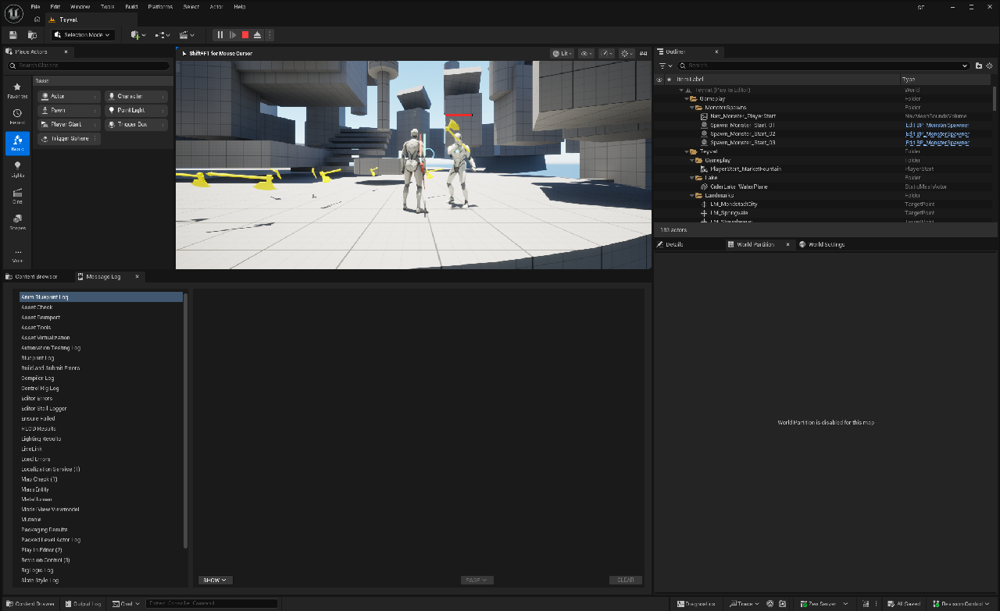

# SPEC-75 어빌리티 구조 개선 — 단계별 제작 파이프라인 적용 사례

플랜·설계·구현 분할을 실제 Unreal 구조 개선에 적용한 사례입니다. 기존 동작별 Native Ability·ASC에 섞인 행동 흐름을 BP 템플릿 중심의 제작 구조로 재분류하고, 같은 템플릿에서 콘텐츠를 반복 제작하는 경로를 검증했습니다.

2026-10-26 SF Team Hub 조회 기준: SPEC-75 Revision 3, Store 288, 확정 플랜 v4, 설계 v6. 이 문서는 해당 구현·검증·발행 기록의 선별 요약이며 제품 테스트를 새로 실행한 결과가 아닙니다.

## 플랜에서 확정한 목표

공통 시스템 계약, BP 템플릿의 행동 조합, 콘텐츠 데이터·리소스의 책임을 분리합니다. 기존 플레이 결과와 몽타주·Notify·외형 편집은 보호하고, 그 기능을 구현한 코드 위치까지 고정하지 않습니다. 캐릭터 정의·AbilitySet·표준 입력과 DT→SBC→GE→AttributeSet 경로를 정식 제작 입력으로 연결합니다.

## 설계에서 결정한 내용

- Native Ability·Task는 공통 시스템 계약과 필요한 실행·비동기 기능을 제공합니다.
- 계열 BP 템플릿은 Task·Tag·Effect로 행동 흐름을 조합하며, 콘텐츠 자손은 데이터·리소스를 변주합니다.
- GAS Commit·End·Cancel과 표준 Task를 재사용하고 별도 수명 상태기계를 복제하지 않습니다.
- ProductionAbility의 실제 BP·그래프·저장값·참조를 목적지로 이행한 뒤 제거합니다.
- 스탯 초기화는 Reset→SBC→Vitals로 구성합니다. 사전 실패 무변경과 시작 후 예외 진단·후속 차단을 구분하며 일반 GAS의 완전 rollback을 주장하지 않습니다.

설계 논점 8개는 합의된 상태로 조회됐고 구현 항목은 설계 v6과 연결됩니다.

## 구현과 반복 제작

근접공격·가드·대시·몬스터의 계열 BP와 콘텐츠 자손, Definition·AbilitySet·프로필·표준 입력을 연결했습니다. 같은 근접공격 부모에서 몽타주와 데이터가 다른 Alternate를 제작했습니다. 기본 HR01/MN01과 GameMode 선택을 보존하면서 신규 C++ 행동 Ability 없이 반복 제작한 범위를 확인했습니다.

위 이미지는 당시 실행 화면입니다. 추적·공격·타깃 상실·재획득 판정은 정지 이미지와 별도로 저장된 실행 관측을 대조합니다.

## 검증과 발행

| 항목 | 확인한 기록 |
| --- | --- |
| 구현 항목 | 18개 완료 |
| 검증 체크리스트 | 19개 사람 PASS, AI 18개 PASS와 실제 플레이 수락 1개 PENDING |
| 최종 별도 프로세스 회귀 | 74개: 성공 65, 경고 포함 성공 9, 실패 0 |
| 실행 관측 | 저장 BP 재로드, Hero 입력·Task 정리, Teyvat 저장 몬스터 추적·공격·타깃 상실·재획득 |
| Dash | 전용 서버·소유 클라이언트의 방향·취소·예측 검증 |
| 원격 main | 당시 d94b38ad5483에서 작업 커밋 4f115b89c083 포함 확인 |
| 발행 | 2026-10-18 CURRENT Revision 3 |

회귀 74개와 검증 체크리스트 19개는 서로 다른 집계입니다. 패키징·성능·인터넷 지연·비소유 프록시 전수검증으로 확대하지 않습니다.

## 다음 제작으로 환원

검증한 제작 경로와 자산 배치·참조·저장/reload 기준을 ability-production Skill, CombatActionGuide, 캐릭터 제작 가이드와 Hero/Monster Recipe에 반영했습니다. 한 기능을 완성한 결과가 다음 Agent 작업의 제작 입력과 검증 기준으로 이어지도록 구성했습니다.

근거는 ProjectSF의 확정 플랜·설계 논점·구현/검증 기록, Issue-75의 ValidationManifest·PIEValidation·TeyvatPIEValidation·AbilityProductionGuidance 및 당시 원격 main 기록입니다. 비공개 원본 전체는 복제하지 않았습니다.
