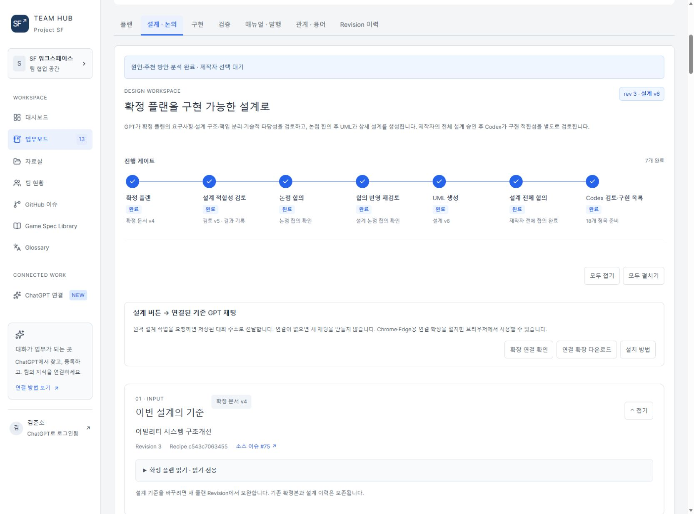
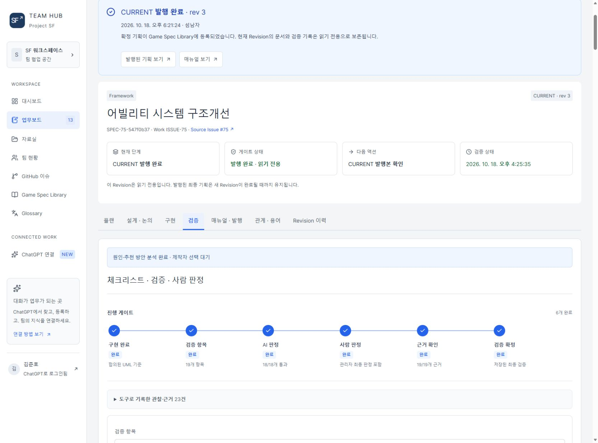

# SPEC-75를 Spec 워크플로우로 진행한 과정

SPEC-75는 어빌리티 시스템 개선이라는 실제 개발 과제를 플랜·설계·구현·검증·발행 단계로 나누어 진행한 사례입니다. 핵심은 기능의 내부 구조보다 제작자와 Agent가 각 단계에서 무엇을 판단하고 어떤 기록을 다음 단계에 넘겼는지에 있습니다.

2026-10-26 읽기 전용 조회에서 SPEC-75 R3 / Store288, 확정 플랜 v4, 설계 v6과 공통 이력280건을 대조했습니다. 현재 UI는 발행된 Revision을 보존한 상태이며 아래 캡처가 당시 작업을 재실행한 결과는 아닙니다.

## 1 제작자와 ChatGPT가 플랜을 보완하고 확정

Issue #75와 접근 가능한 코드·문서를 참고해 요구, 범위, 보존 대상과 수용 기준을 작성했습니다. ChatGPT의 제안 반영·플랜 보완과 제작자 확정은 각각 기록됐습니다. 확정 플랜 v4가 설계 단계의 입력이 됐습니다.

## 2 Agent가 확정 플랜과 현재 원본을 대조

설계 적합성 검토를 요청하고 Agent가 기존 시스템과 실제 코드·선택 BP·DT/DA를 대조했습니다. 재사용·변경·보존·미확인을 구분해 결과를 저장했습니다. 초기 작업 실패와 이후 검토 완료는 함께 이력에 남으며, 검토 PASS는 미래 구현·실행 성공과 구분됩니다.

## 3 논점을 분석하고 제작자가 방안을 선택

검토에서 드러난 논점은 현상·원인·근거와 추천·대안으로 정리했습니다. 실제 이력에는 ANALYZE_DISCUSSION, DISCUSSION_OPTIONS_CREATED, AGREE_DISCUSSION과 REOPEN_DISCUSSION이 이어집니다. 예를 들어 스탯 초기화 실패 정책은 합의 후 다시 열어 재검토하고 합의했습니다. 이 과정에서 선택 내용과 이전 합의 이력을 보존했습니다.

## 4 합의를 UML에 반영하고 전체 설계를 합의

논점 결론을 바탕으로 UML 생성·재생성, 제작자의 Mermaid 수정, 재검토를 진행했습니다. 개별 논점 합의와 전체 설계 합의(APPROVE_DESIGN)는 별도 기록입니다. 최종 설계 v6을 구현 인계의 기준으로 사용했습니다.

## 5 Codex가 설계를 검토하고 구현 목록으로 인계

전체 설계 합의 뒤 REQUEST_IMPLEMENTATION과 IMPLEMENTATION_PLAN_CREATED가 기록됐습니다. 설계 요소에 연결된18개 항목에 대상·변경 내용·선행 작업·완료 조건·검증 방법을 담았습니다. 실제 구현은 해당 저장소와 Hub에 접근하는 Codex로 인계했습니다.

## 6 항목별 실행 결과를 기록하고 완료 상태를 동기화

작업 중 PAGE_RESULT implementation으로 항목별 실행 결과와 Evidence를 남겼습니다. 구현 기록과 현재 설계·완료 조건을 대조한 뒤 REVIEW_IMPLEMENTATION과 SYNC_IMPLEMENTATION으로 완료 상태를 맞췄습니다. 대화가 바뀌어도 저장된 항목과 근거를 읽어 진행을 복원할 수 있도록 구성했습니다.

## 7 구현과 검증, AI와 사람 판정을 분리

구현 항목에 연결된19개 체크리스트에 기대 결과·실제 근거·AI 판정·사람 판정을 기록했습니다. Agent는 코드·저장 자산·실행 기록을 대조하고 제작자는 실제 플레이를 확인했습니다. 최종 상태는 구현18개 완료, 사람 판정19개PASS, AI 검증 대상18개PASS입니다. 실제 플레이 수락 항목은 사람PASS·AI PENDING이며 역할을 혼합하지 않았습니다.

## 8 VERIFY 이후 매뉴얼과 원격 반영을 확인하고 발행

VERIFY → 매뉴얼 변경 → REMOTE_MAIN_VERIFIED → PUBLISH_FINAL_PLANNING 순서가 이력에 남아 있습니다. 당시 원격main d94b38ad5483에서 작업 커밋4f115b89c083 포함을 확인한 뒤 2026-10-18 CURRENT R3를 발행했습니다. 문서·결정·검증 기록은 읽기 전용으로 보존됐습니다.

이 사례는 사람이 목표와 합의를 결정하고, Agent가 각 단계의 검토·실행 근거를 남기며, 사이트가 확정 버전과 다음 단계를 유지하는 방식으로 개발을 진행한 기록입니다. 논점 재개방과 UML 수정·재인계가 포함된 실제 왕복 과정이며 한 번의 자동 실행으로 모든 단계를 통과했다고 표현하지 않습니다.

## 추가 참고 당시 구현과 검증

아래는 이 워크플로우로 수행한 기술 작업의 기존 기록입니다.

# SPEC-75 어빌리티 구조 개선 — 단계별 제작 파이프라인 적용 사례

플랜·설계·구현 분할을 실제 Unreal 구조 개선에 적용한 사례입니다. 기존 동작별 Native Ability·ASC에 섞인 행동 흐름을 BP 템플릿 중심의 제작 구조로 재분류하고, 같은 템플릿에서 콘텐츠를 반복 제작하는 경로를 검증했습니다.

2026-10-26 SF Team Hub 조회 기준: SPEC-75 Revision 3, Store 288, 확정 플랜 v4, 설계 v6. 이 문서는 해당 구현·검증·발행 기록의 선별 요약이며 제품 테스트를 새로 실행한 결과가 아닙니다.

## 플랜에서 확정한 목표

공통 시스템 계약, BP 템플릿의 행동 조합, 콘텐츠 데이터·리소스의 책임을 분리합니다. 기존 플레이 결과와 몽타주·Notify·외형 편집은 보호하고, 그 기능을 구현한 코드 위치까지 고정하지 않습니다. 캐릭터 정의·AbilitySet·표준 입력과 DT→SBC→GE→AttributeSet 경로를 정식 제작 입력으로 연결합니다.

## 설계에서 결정한 내용

- Native Ability·Task는 공통 시스템 계약과 필요한 실행·비동기 기능을 제공합니다.
- 계열 BP 템플릿은 Task·Tag·Effect로 행동 흐름을 조합하며, 콘텐츠 자손은 데이터·리소스를 변주합니다.
- GAS Commit·End·Cancel과 표준 Task를 재사용하고 별도 수명 상태기계를 복제하지 않습니다.
- ProductionAbility의 실제 BP·그래프·저장값·참조를 목적지로 이행한 뒤 제거합니다.
- 스탯 초기화는 Reset→SBC→Vitals로 구성합니다. 사전 실패 무변경과 시작 후 예외 진단·후속 차단을 구분하며 일반 GAS의 완전 rollback을 주장하지 않습니다.

설계 논점 8개는 합의된 상태로 조회됐고 구현 항목은 설계 v6과 연결됩니다.

## 구현과 반복 제작

근접공격·가드·대시·몬스터의 계열 BP와 콘텐츠 자손, Definition·AbilitySet·프로필·표준 입력을 연결했습니다. 같은 근접공격 부모에서 몽타주와 데이터가 다른 Alternate를 제작했습니다. 기본 HR01/MN01과 GameMode 선택을 보존하면서 신규 C++ 행동 Ability 없이 반복 제작한 범위를 확인했습니다.

위 이미지는 당시 실행 화면입니다. 추적·공격·타깃 상실·재획득 판정은 정지 이미지와 별도로 저장된 실행 관측을 대조합니다.

## 검증과 발행

| 항목 | 확인한 기록 |
| --- | --- |
| 구현 항목 | 18개 완료 |
| 검증 체크리스트 | 19개 사람 PASS, AI 18개 PASS와 실제 플레이 수락 1개 PENDING |
| 최종 별도 프로세스 회귀 | 74개: 성공 65, 경고 포함 성공 9, 실패 0 |
| 실행 관측 | 저장 BP 재로드, Hero 입력·Task 정리, Teyvat 저장 몬스터 추적·공격·타깃 상실·재획득 |
| Dash | 전용 서버·소유 클라이언트의 방향·취소·예측 검증 |
| 원격 main | 당시 d94b38ad5483에서 작업 커밋 4f115b89c083 포함 확인 |
| 발행 | 2026-10-18 CURRENT Revision 3 |

회귀 74개와 검증 체크리스트 19개는 서로 다른 집계입니다. 패키징·성능·인터넷 지연·비소유 프록시 전수검증으로 확대하지 않습니다.

## 다음 제작으로 환원

검증한 제작 경로와 자산 배치·참조·저장/reload 기준을 ability-production Skill, CombatActionGuide, 캐릭터 제작 가이드와 Hero/Monster Recipe에 반영했습니다. 한 기능을 완성한 결과가 다음 Agent 작업의 제작 입력과 검증 기준으로 이어지도록 구성했습니다.

근거는 ProjectSF의 확정 플랜·설계 논점·구현/검증 기록, Issue-75의 ValidationManifest·PIEValidation·TeyvatPIEValidation·AbilityProductionGuidance 및 당시 원격 main 기록입니다. 비공개 원본 전체는 복제하지 않았습니다.
