# AI Agent 기반 게임 제작 사례

**2026-10-14 기준의 과거 제작·검증 Snapshot.** 이 페이지의 이슈 상태, 월드 지표, 검증 시점은 해당 날짜의 자료다. 이후 ProjectSF는 대규모 GIS 기반 NeoSeoul 재현을 신규 월드의 기본 설계로 삼지 않고, 공간을 의도적으로 압축한 선형 탐험형 액션 어드벤처 방향으로 전환했다. 아래 실제 화면·Evidence는 이전 프로토타입의 공학적 사례로만 사용하며 새 월드 제작 완료 근거가 아니다.

Creator가 설계와 완료 기준을 정하고, Agent가 구현과 기본 회귀검증을 수행한 실제 제작 사례를 월드·전투·MetaHuman 영역으로 정리한다. 제작 화면과 데이터·연결 구조를 함께 제시하고, 기술 검증과 Creator 검수·Issue 종료를 구분한다.

```text
Creator 설계 → AI Agent 구현 → 자동 검증
→ Creator 수용 / 이슈 종료 → Programmer 종합 검토 → 제작 공정 개선
```

ProjectSF가 제품 구현과 운영 계약의 Source of Truth이며, 이 저장소는 공개용 포트폴리오 Snapshot이다. 개별 기능과 공정 개선의 근거를 프로젝트별 전담 프로그래머 없이 제작하는 장기 목표와 구분한다. 전체 역할 모델은 [Creator-Centric Production Engineering](../Docs/CreatorCentricProduction.md)을 참고한다.


다음 사례는 결과 화면과 함께 Creator의 설계, Agent의 구현·검증, 사람의 피드백과 기반 개선을 연결한다.

### 이전 NeoSeoul 월드 제작 파이프라인을 실제 지역에 적용

**제작 목표:** 서울 GIS를 게임용 지형·도로·수계로 연결하고, 생성 후에도 부분 수정과 결과 검증을 이어갈 수 있는 제작 파이프라인을 구축한다.

| 제작 단계 | 실제 작업과 판단 |
| --- | --- |
| Creator Design | 공통 좌표·단위, 러프 월드와 상세 지역 범위, 기존 지형·수계·수작업 보존, 실제 화면·접지·저장 검증 기준 정의 |
| Agent Implementation | GIS 변환과 Landscape 입력, polygon 기반 도로면, 차선·보도와 Native Water 제작 도구 연결; RoadBatch 등 반복 실행 기반 구현 |
| Automated Validation | 입력·구간 identity와 hash, 실제 결과 readback, scoped save/reload, 비대상 보존과 대표 보행·충돌 확인 |
| Creator Feedback | 화면에 남은 도로 접합 틈과 원거리 가림을 발견하고 국소 수정 또는 rough 한계 수용 판단 |
| Workflow Improvement | 불확실한 mutation 자동 재실행 방지, 기존 결과 변화 감지, 재사용 가능한 profile·batch·검증 계약 정비 |

#### 공간 분할과 도메인 레이어

World Partition의 로드·저장 구조, 행정구역별 제작 범위, 지형·수계·도로의 도메인 책임, batch 청크를 별도로 추적한다. 행정구역과 streaming cell을 같은 경계로 고정하지 않고, 구역을 가로지르는 도로·수계의 feature identity와 생성 owner를 유지한다.

지형은 Base와 수계 굴착·basin·호안 보정 Landscape Edit Layer를 분리한다. 수계는 지형 준비와 Native River/Lake·WaterZone을, 도로는 기반 도로면과 차선·보도를 분리한다. 생성물만 선택해 수정하고 기존 지형·수작업·공유 도로·수계를 보호한다.


위 그림은 확인한 계약·저장 검증에 근거한 설명 도식이다. 모든 제작 레이어를 Unreal Data Layer로 구현했다고 해석하지 않는다. [월드 사례의 공간 분할과 레이어 구조](WorldProduction.md#공간-분할과-레이어-구조)에서 각 경계와 부분 수정·검증 책임을 확인할 수 있다.

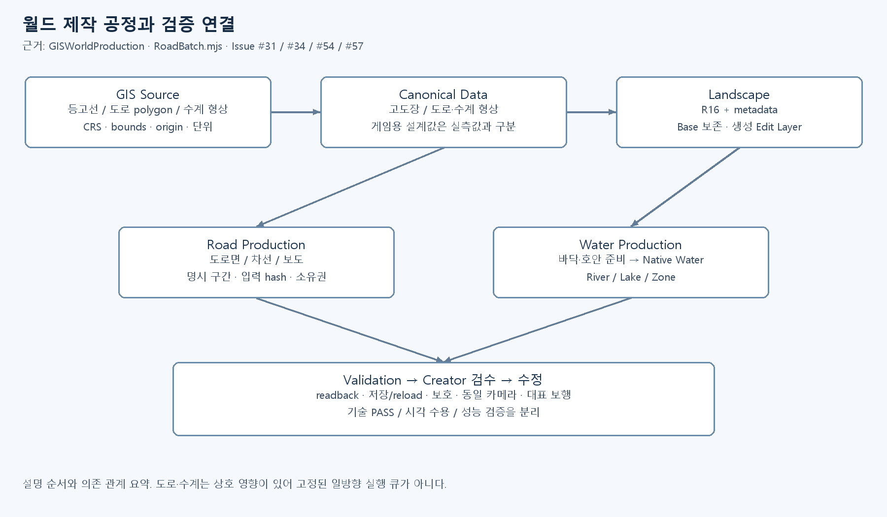

그림 1. 실제 문서·도구를 기준으로 정리한 공정 도식. 지형·도로·수계 입력과 검증 책임을 연결한다. Unreal Editor 화면 캡처와 구분한다.

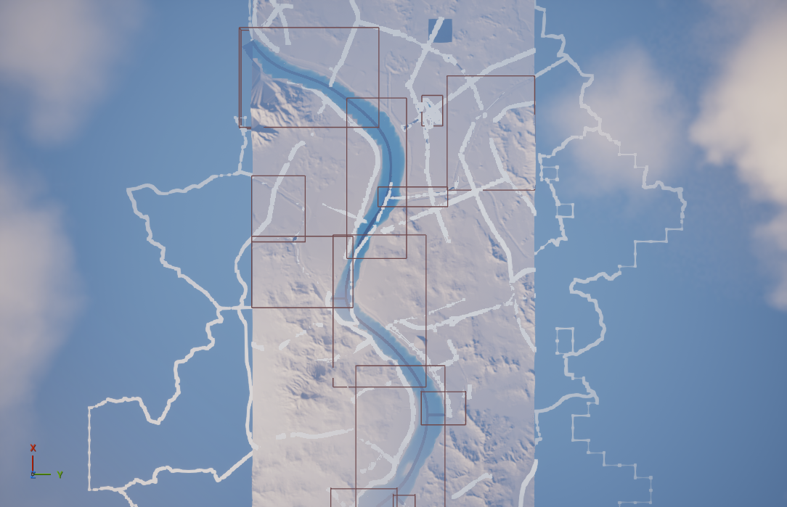

그림 2. 2026-10-07 저장 상태 검증의 전체 기반 화면. 지형·수계·구역 표시를 보여주며 서울 전체 상세 콘텐츠의 완성을 의미하지 않는다.

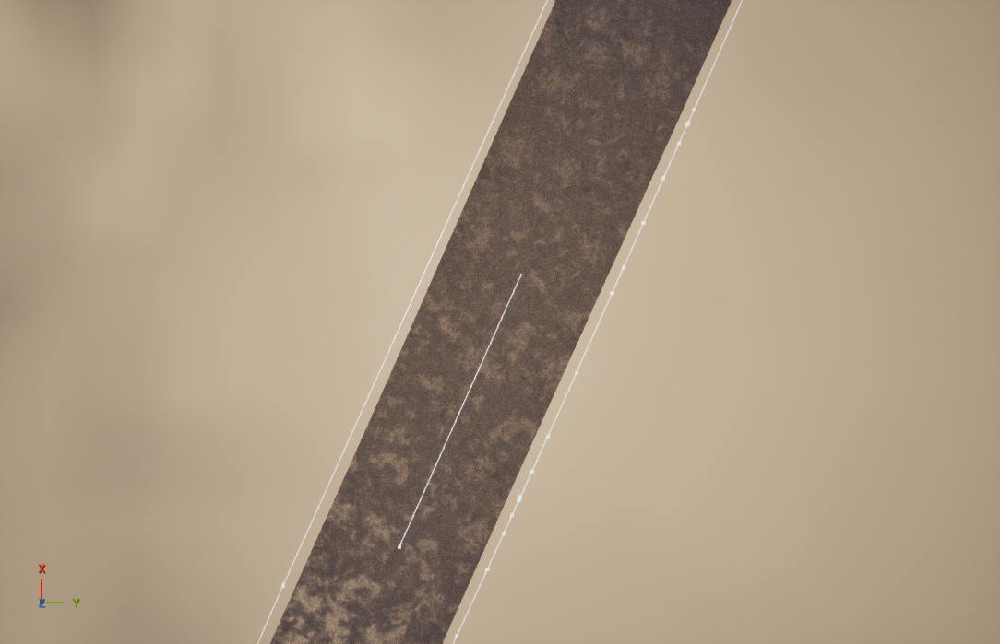

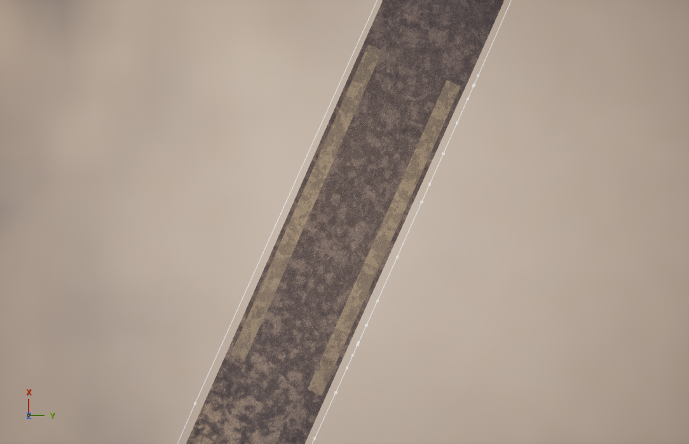

그림 3–4. #54 대표 S001 구간의 2026-10-08 전후 화면. 기존 도로면을 유지하면서 차선·양측 보도를 연결한 제작 단계를 보여준다. 이 한 쌍을 확대된 247구간 전체의 품질 근거로 승계하지 않는다.

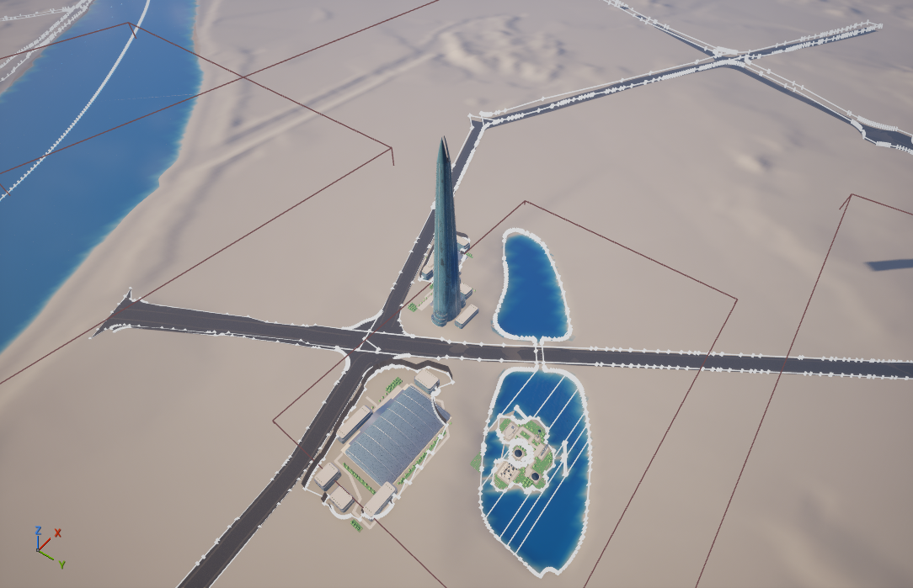

그림 5. #57 롯데 지구의 WholeSiteComposition7 화면. 공통 지형·도로·수계 위에 타워·몰·섬의 공간 관계를 연결한 rough 단계이며 최종 아트·LOD·성능 승인 화면은 아니다.

**2026-10 시점 판정:** #54의 확대 playable rough는 Owner가 한계를 포함해 수용했다. 수계 최종 표현, 원거리 LOD 가림, 패키지 실행과 목표 하드웨어 성능은 각각 남은 검증 범위다.

### Creator의 전투 시스템 제작 과정

**제작 목표:** 공격·가드·이동 전환을 실제 입력과 편집 가능한 몽타주로 연결하고, 공격 판정·적 행동·카메라를 단계적으로 개선한다. 전투의 타이밍과 체감은 Creator가 플레이하며 다듬는다.

| 제작 단계 | 실제 작업과 판단 |
| --- | --- |
| Creator Design | 우클릭 Press/Hold/Release 가드, 좌클릭 3타와 입력 예약, 회복 구간 이동·점프 전환, 적마다 1회 접촉, 락온 시 공격 시작 방향 보정 요구 |
| Agent Implementation | GAS Ability와 Enhanced Input, 개별 Montage·Notify, BP 본/소켓 공격·피격 부위, CameraProfile·HUD, 액션/캐릭터 프로필 연결 |
| Automated Validation | 실제 PIE 입력, 조기 해제·취소·중복 입력, 태그·잠금 정리, 접촉 횟수·HP 감소, 저장·재시작 readback과 기존 동작 회귀 |
| Creator Feedback | BP Components에서 직접 부위를 조절하고 몽타주에서 타이밍·보호 구간을 편집; 실제 플레이에서 카메라·방향·거리 조정 |
| Workflow Improvement | 입력 버퍼와 실제 공격 시작 책임 분리, montage 원래 시간/GUID 보존, BP gameplay 중복값을 정의·프로필 데이터로 정리 |

진행 사례는 #44 가드, #45 콤보, #49 접촉 판정, #62 데이터 프로필, #64 카메라, #65 공격 방향 보정으로 연결된다. #44·#45는 closed지만 #49·#62·#64·#65는 조회 시점에 open이다. 기능별 기술 검증과 전투 시스템 전체의 완료·Creator 체감 승인을 구분한다. #55의 H00002 전투 설계에서 제안한 Just Dodge·Counter 등도 이 구현 사례 전체가 이미 지원하는 것으로 확대하지 않는다.

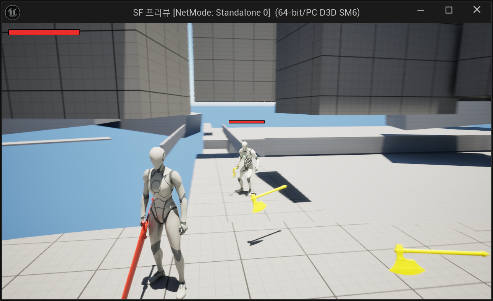

그림 6. #64의 2026-10-10 Teyvat Standalone PIE 화면. 플레이어·몬스터 체력과 타깃 표시가 연결된 결과다. 화면에 남은 분리된 무기 외형은 당시 테스트 상태이며 완성된 전투 아트로 제시하지 않는다.

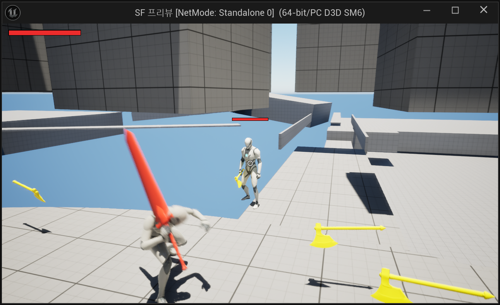

그림 7. #65의 2026-10-10 락온 공격 검증 화면. 공격 실행 장면과 함께 보고서의 회전·피해·취소 관측을 읽는다. 정지 이미지 자체는 콤보 전체·타격 횟수·네트워크 예측을 증명하지 않는다.

**데이터와 연결 구조:** 부모 BP는 외형·ABP·본/소켓 컴포넌트를 소유하고, HR01/MN01 자손은 캐릭터 정의 행을 선택한다. 정의는 이동·액션·AI 프로필, 스탯·AbilitySet·무기를 참조한다. 몽타주 타이밍은 Notify에서, 공격·피격 shape 배치는 BP에서, 재생·거리·쿨타임 등 gameplay 설정은 데이터에서 관리한다.

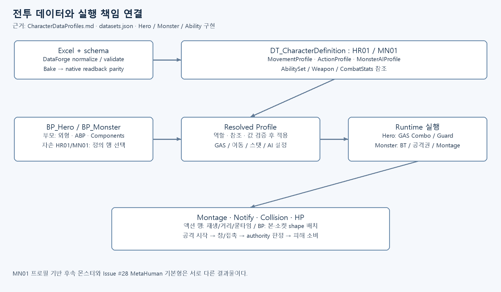

그림 8. 현재 제품 문서·dataset 등록·소스에서 확인한 연결 구조. #62의 MN01 후속 몬스터와 다음 MetaHuman #28 기본형은 서로 다른 결과물이다.

**2026-10 시점 판정:** 초기 가드·콤보는 PIE와 종료 정리·저장 검증이 기록되어 있다. #62는 Editor/Game 빌드와 25/25 자동검사·프로필 parity가 기록되어 있다. #64의 2026-10-14 카메라 3·4단계는 작업 브랜치 제출까지 확인됐으나 main 반영·최종 Owner 체감 검수는 대기 상태다. 테스트 수는 단계별 결과로 합산하지 않는다.

### Creator의 MetaHuman 기본 몬스터 제작 과정

**제작 목표:** MetaHuman 기반 기본 몬스터의 편집 가능한 외형과 애니메이션을 게임 캐릭터 구조에 연결하고, 공격·복귀 동작을 단계별로 검증한다.

| 제작 단계 | 실제 작업과 판단 |
| --- | --- |
| Creator Design | 원하는 외형과 게임 내 역할, 편집 원본 유지, 월드 배치·변형·저장 검증 기준 및 몬스터의 전조·공격·복귀 규칙 정의 |
| Agent Implementation | #28의 MHC_BasicMelee 원본·조립 BP·Body/Face/Clothing 참조 유지, 애니메이션·리타게팅·몬스터 BP와 기능 연결 |
| Automated Validation | 실제 PIE mesh/AnimInstance/Leader Pose 조회, 일반·강공격·후딜·복귀 관측, 전투·스탯 자동검사, 통합 후 MapCheck·관련 회귀 |
| Creator Feedback | 외형과 전투 리듬, 발 접촉과 의상 움직임을 실제 플레이로 검수하고 수정 방향 결정 |
| Workflow Improvement | 공용 스탯 조립의 입력 검증·실패 보존·재적용 규칙을 정비하고 Hero/Monster 제작 템플릿·가이드·회귀 테스트에 환원 |

**검증 대상:** #28의 MetaHuman 기반 기본 몬스터에서 실제 기록된 외형 연결 및 일반·강공격·복귀 경로만 다룹니다. 기술 검증과 최종 제작자 수용은 별도로 판정합니다.

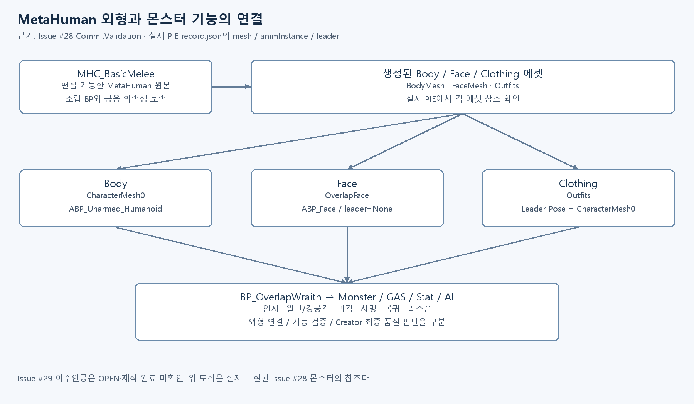

그림 9. #28 실제 PIE 조회 기록 기준의 외형 연결 도식. Body는 `ABP_Unarmed_Humanoid`, Face는 `ABP_Face`, Clothing은 Body의 Leader Pose를 사용한다. 도식은 에디터 캡처가 아니라 확인한 참조 관계의 설명 이미지다.

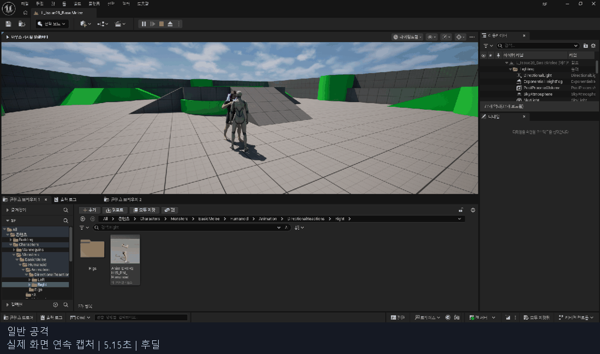

그림 10. 2026-10-06 실제 캡처 `normal.gif`의 4번째 프레임. MetaHuman 외형을 연결한 몬스터와 테스트 플레이어의 일반 공격 검증 장면이다.

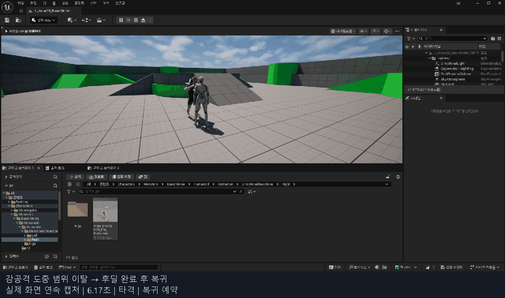

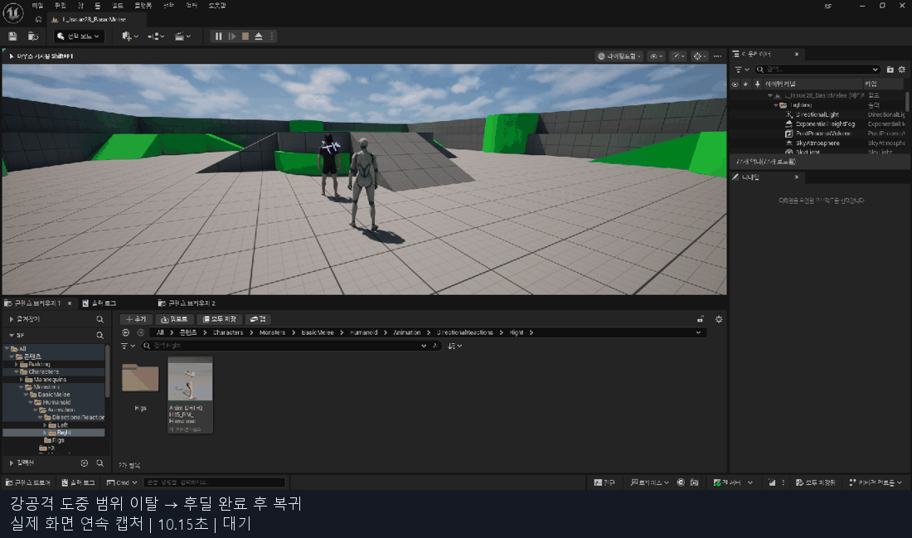

그림 11–12. 실제 `heavy-return.gif`의 5·8번째 프레임. 강공격 도중 범위를 벗어나도 행동을 완료한 뒤 복귀하도록 검증한 장면이다. 기존 GIF의 자막을 보존했으며 프레임을 생성·보간하지 않았다. 약 1초 간격 캡처여서 고프레임 연속 동작·미세한 발 미끄러짐의 품질 판정에는 사용하지 않는다.

**2026-10 시점 판정:** #28은 전체 작업이 종료되지 않았으나, 아래 기술 검증 항목은 실제 근거가 기록되어 있습니다. 일반/강공격·복귀와 외형 참조의 기술 근거, main 통합 후 9개 자동검사(성공 8·경고 포함 성공 1, 실패 0) 및 MapCheck 오류·경고 0이 기록되어 있다. 통합 후 렌더링 PIE·cook·멀티플레이·최종 Creator 외형/전투 감각 승인은 별도 미검증이다. 공용 프레임워크 개선을 #28 전체 Acceptance 완료로 이전하지 않는다.
