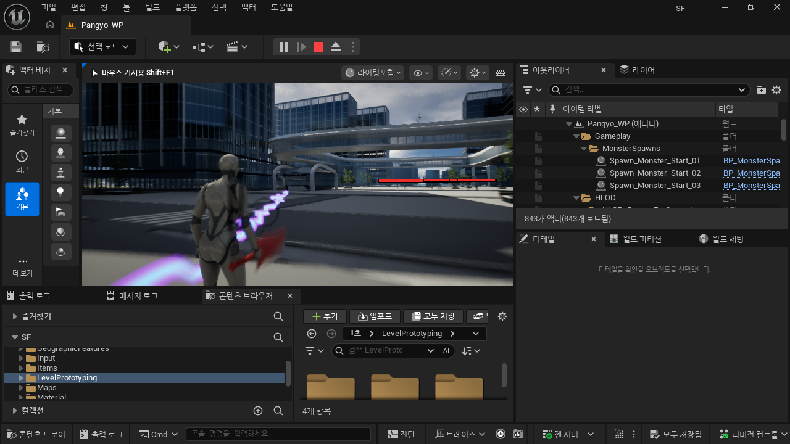
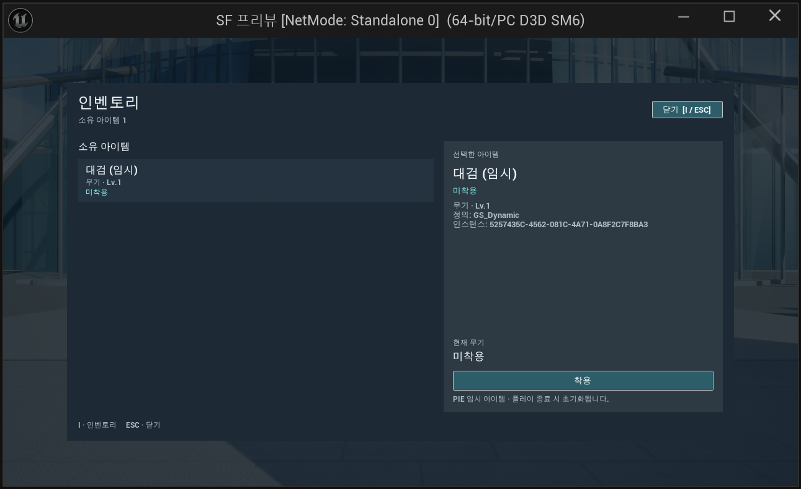

# 그래플링과 인벤토리 제작

판교 월드에서 확인한 그래플링 이동과 인벤토리는, Creator의 설계를 실행 Agent가 구현하고 검증한 사례입니다. 같은 기능 영역이라도 기본 그래플링과 후속 자원·HUD 개편은 별도 Spec으로 관리합니다.

## 그래플링 이동

조준과 발사, 유효 표면의 앵커 설치, 당김, 도착·취소를 분리했습니다. 서버에서 앵커 설치를 확인하고 소유 클라이언트가 앵커 준비를 관측한 뒤, 잠금 시간 조건까지 충족해야 당김을 시작합니다. 앵커 준비 지연과 늦게 도착한 이벤트, 도착 시 운동량은 별도 회귀 조건으로 다뤘습니다.

2026-11-10 판교 Editor 플레이 캡처. 그래플링 효과를 관측한 화면입니다. 네트워크 동기화는 이 화면과 별개로 소유 클라이언트 시험 기록에서 확인했습니다.

11월 10일 검증에는 소유 클라이언트의 벽 당김과 공중 당김 취소, 최종 자동화 **78/78 통과** 기록이 있습니다. 기본 이동 Spec은 검증·제품 main 확인 후 `CURRENT`로 발행됐습니다. 외부 운영망이나 패키지 전체 성능을 검증한 결과는 아닙니다.

### 그래플 자원과 HUD 후속 작업

사용 횟수·회복·쿨다운·실패 시 정산을 별도 Spec에서 다룹니다. 작업본은 Excel 프로필을 DataForge를 통해 DataTable에 연결하고, GAS가 자원을 관리하며 HUD는 표시만 맡도록 구성합니다. 로컬 시험 기록은 있으나 현재 Hub에서는 **구현 중**입니다. 기본 그래플링의 발행 이력을 이 후속 작업에 적용하지 않습니다.

## 인벤토리와 무기 착용

서버의 인벤토리 모델이 착용 요청과 상태를 관리하고, Item 도메인의 통신을 분리했습니다. 클라이언트 UI는 소유 아이템과 착용 상태를 표시하고 선택한 장비의 착용 요청을 보냅니다. 이 변경의 제품 main 반영과 `CURRENT` 발행을 확인했습니다.

기존 로컬 Standalone 시험 화면입니다. 임시 대검의 목록·상세·착용 조작을 보여 주며, 이 화면만으로 영속 인벤토리나 원격 서비스 운영을 증명하지 않습니다.

## 입력과 카메라의 후속 정리

PlayerController에 모였던 Hero 입력과 락온 실행을 분리하고, 락온을 Gameplay Ability로 옮겼습니다. 카메라의 변경은 별도 책임으로 유지합니다. 해당 리팩터링은 원격 main 병합 및 Hub `CURRENT` 발행을 확인했습니다. 과거 락온 화면은 [초기 전투 제작 사례](AgentDrivenGameProduction.md)에 남겨 두었습니다.

[판교 시작 지역 제작](PangyoWorldProduction.md) · [검증 기준과 상태](../Docs/SourceAudit-2026-11-13.md)
