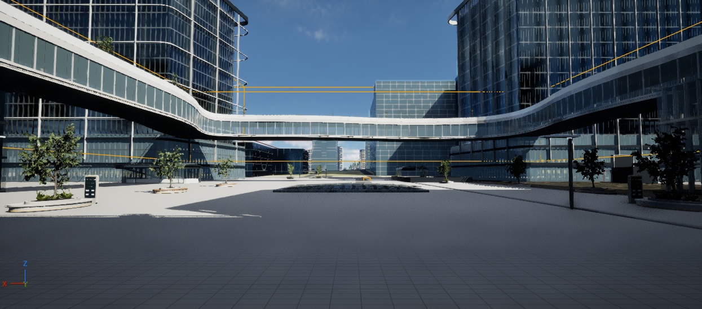
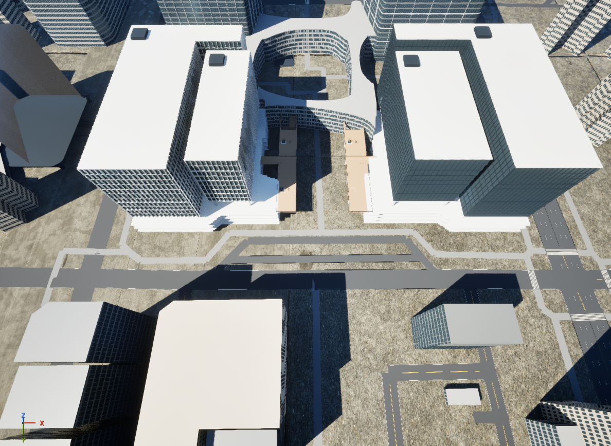
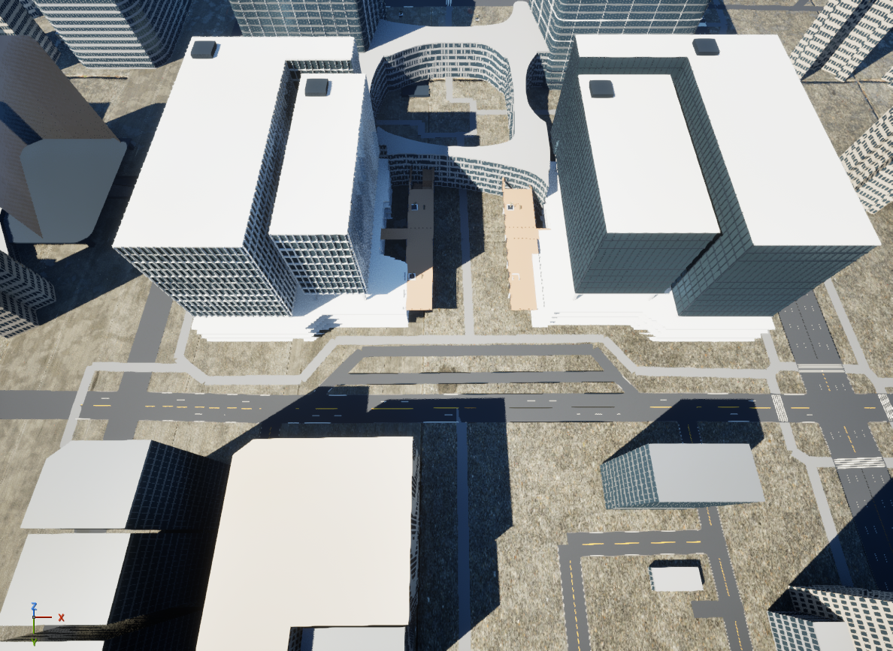
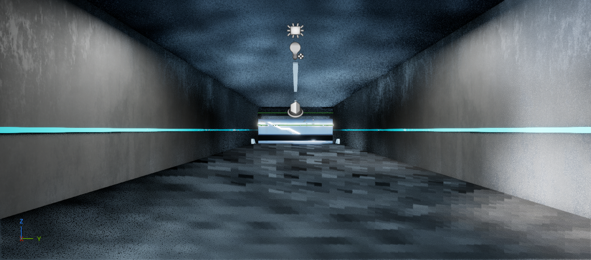
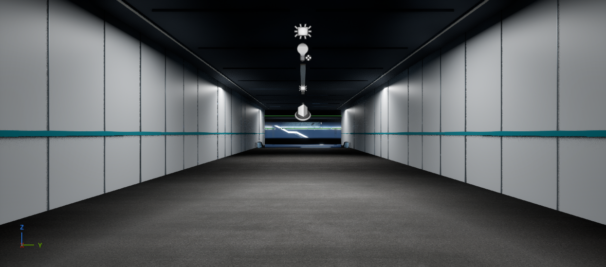
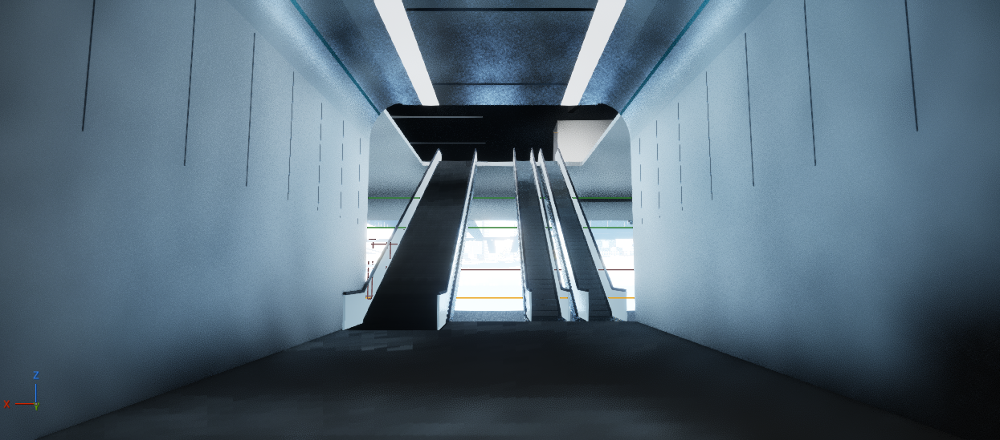

# 판교 시작 지역 제작

Trace는 주요 경로와 탐색 구역을 연결하는 선형 탐험형 액션 어드벤처입니다. 판교는 그 시작 지역입니다. 초기 NeoSeoul 실험에서 개발한 공간·제작 단위 분리 원칙을 이어받되, 이번에는 현실 지도의 충실한 재현보다 **지상 광장과 지하 역사 사이를 어떻게 탐색하고 이동하는지**를 기준으로 공간을 편집합니다.

2026-11-04 Unreal Editor 제작 캡처. 광장과 상부 연결부의 형태를 보여 줍니다.

## 지상과 지하를 나눠 제작하고 동선으로 연결

| 작업 | 구현과 확인 |
| --- | --- |
| 지상 | 도로면·차선, 광장, 보행 연결부와 역사 출입구를 구분해 편집했습니다. 도로의 기본 형상을 보존하면서 표시를 바꾼 전후 화면을 아래에 남겼습니다. |
| 지하 | 대합실·승강장·환승부·지하 연결 통로를 구분했습니다. 층 높이와 연결 위치를 먼저 맞추고, 통로의 조명·벽·바닥과 환승부 마감을 따로 조정했습니다. |
| 저장과 재개 | 구간별 입력과 생성물의 관계를 남깁니다. 전후 화면과 저장 결과를 확인해 다음 작업에서 어느 범위를 이어서 수정할지 판단할 수 있게 합니다. |

### 도로 차선 적용 전후

| 적용 전 | 적용 후 |
| --- | --- |
|  |  |

2026-10-31 같은 구도의 Editor 검토 화면입니다. 건물 사이 도로에서 차선 표시가 바뀐 부분을 비교할 수 있습니다.

### 지하 연결 통로와 환승부

| 연결 통로 조정 전 | 연결 통로 조정 후 |
| --- | --- |
|  |  |

2026-11-04 통로 검토 캡처. 바닥·벽·천장 조명 변경으로 입구 방향과 통로 깊이가 어떻게 읽히는지 비교했습니다.

2026-11-05 환승부 정적 마감 캡처. 계단·에스컬레이터 주변의 공간과 조명을 보여 줍니다. 이동 장치의 동작이나 전체 경로의 플레이 검증을 나타내지는 않습니다.

## 공간 분할과 저장 구조

- **World Partition**은 공간 로딩과 원거리 표시 구조를 관리합니다. 런타임 격자, 제작 청크, 플레이 동선은 각각 추적합니다.
- **Data Layer**는 실제 판교 에셋에서 확인했습니다. 역사 외형에 콘텐츠 레이어가 연결되어 있고, 환경 Actor에서는 콘텐츠·런타임 레이어 연결을 각각 읽었습니다. 이 기록은 저장된 할당의 관측이며 플레이 중 전체 레이어 전환의 검증은 아닙니다.
- **HLOD**는 원거리 표시용 파생 결과입니다. 11월 5일 체크포인트에서 카탈로그 643개 중 로드된 451개를 대조했습니다. 당시 카탈로그 검사에서 누락·포인터 패키지나 빈 메시 결과가 보고되지 않았습니다. 미로드 192개는 같은 범위의 소스 대조로 계산하지 않으며, 이 수치로 패키지 성능을 판단하지 않습니다.

## 확인된 범위

판교 기본 월드와 후속 제작 체크포인트는 ProjectSF 원격 main에 반영됐습니다. **판교 제작 Spec은 계속 구현 중**입니다. 현재 화면과 저장 기록은 해당 지역·구간의 제작 결과입니다. 지상·지하를 잇는 전체 플레이 경로, 최종 시각 수용, 패키지·목표 하드웨어 성능은 이번 확인 범위에 포함되지 않습니다.

[초기 NeoSeoul GIS 제작](WorldProduction.md) · [그래플링·인벤토리 사례](GameplayWorkflow-20261113.md) · [검증 기준과 상태](../Docs/SourceAudit-2026-11-13.md)
