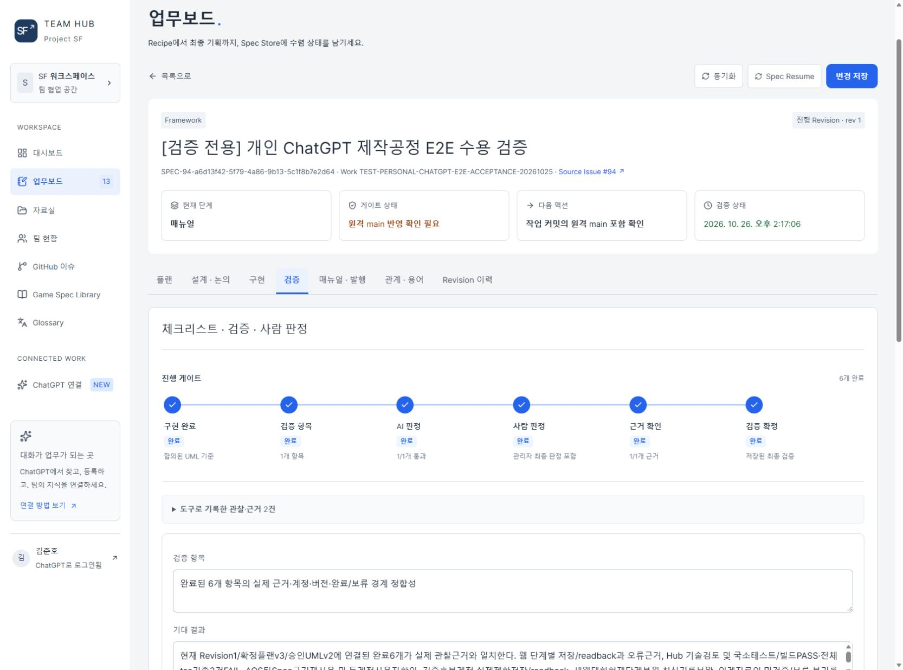

# SF Team Hub — Issue 제작에서 Spec 기반 제작으로 확장한 사례

ProjectSF에서 기존 **GitHub Issue 기반 경량 제작을 유지**하면서, 다자간 기획·설계 합의와 구현·검증·발행이 필요한 작업에 **SF Team Hub Spec 경로**를 도입한 사례입니다.

**2026-10-26 갱신:** 공통 서버 MCP 검증, Spec94의 현재 저장 상태와 실제 사이트 화면을 반영했습니다. ProjectSF 원격 main `a886641a78db`와 현재 운영 기록을 대조했습니다. 기존 SPEC-74/v133 수치는 당시 이력이며, 이번 사이트 캡처는 저장·합의·구현·발행을 재실행한 결과가 아닙니다. [실사 범위](../Docs/SourceAudit-2026-10-26.md) · [실제 공정 화면 7개](../Docs/SFTeamHubWorkflow.md) · [포트폴리오 PDF](../Docs/Guides/AgentWorkflowPortfolio-20261026.pdf)

## 변경 배경

기존 Issue는 개별 Goal·Scope·Acceptance와 코드 변경·검증을 추적하기에 적합했습니다. 반면 복합 Spec에서는 기획 초안, 기술 논점, 설계 합의, 구현 대상, AI·사람 검증과 발행 이력을 Issue 본문·댓글 하나에 계속 누적하는 방식만으로는 **현재 확정된 버전과 다음 단계**를 구분하기 어려웠습니다.

모든 Issue를 옮기거나 Team Hub를 유일한 작업 경로로 만드는 대신 다음처럼 책임을 나눴습니다.

| 실행 경로 | 사용 범위 | 상태 원본 |
| --- | --- | --- |
| GitHub Issue | 소규모 시스템 정비, 기능 추가, 버그 수정 | Goal·Scope·Acceptance·현재 결정·진척 |
| Team Hub Spec | 다자간 플랜, 설계·논점 합의, 구현 목록, 검증·발행 | Spec·Revision·Stage·Gate·문서/판정 이력 |
| 직접 요청 | 영속 일감이 필요 없는 작은 조회·수정 | 현재 승인 요청과 실제 대상 |

**Issue 자체를 Team Hub로 이관하지 않습니다.** 이미 존재하는 Issue는 원본 요구와 연결되고, 상세 실행·논점·버전·수용 상태는 Spec이 관리합니다. CommonAIWorkflow는 경로별 상태를 중복 정의하지 않고 공통 실행·안전·검증만 관리합니다.

## 설계한 실행 흐름

```text
Creator 목표 / 기존 Issue 또는 새 Recipe
              ↓
       Team Hub Spec 등록
              ↓
    플랜 작성·보완 / 제작자 확정
              ↓
 설계 적합성 검토 / 논점 합의 / 재검토
              ↓
    UML 생성 / 제작자 전체 설계 합의
              ↓
   Codex 구현 적합성 검토 / 구현 목록
              ↓
   AI Agent 구현 / 단계별 Evidence
              ↓
     AI 검증 / 사람 검증
              ↓
     가이드 / 원격 main 확인
              ↓
           CURRENT 발행
```

- **GitHub Issue:** 최초 요구와 완료 조건을 보존합니다.
- **Spec Store:** 각 Revision의 문서·질문·논점·구현 항목·검증·결정·발행 기록을 소유합니다.
- **업무보드:** 저장된 Stage·Gate와 차단 원인, 다음 행동을 보여주며 별도 완료 상태를 만들지 않습니다.
- **Agent:** 현재 Spec/문서 버전을 조회한 뒤 필요한 항목만 읽고, 승인된 작업을 실행·기록한 후 결과를 다시 조회합니다.
- **Creator:** 플랜·설계의 명시적 확정과 실제 제품 결과 수용, 발행 판단을 책임집니다.

출력 성공과 서버에 저장된 결과, 구현 항목 완료, AI 검증, 사람 검증, 원격 `main` 반영, CURRENT 발행은 각각 다른 상태입니다. 수정 중 새 Revision이 생겨도 기존 결정과 발행본을 임의로 삭제하거나 덮어쓰지 않습니다.

## 실제 적용 사례 — SPEC-74 Revision 3

**대상:** [ProjectSF Issue #74 — 업무보드·제작 워크플로](https://github.com/islandnboy/ProjectSF/issues/74)

Issue #74에서 Team Hub 자체를 기존 기능과 대조해 정식 요구·검증 경계를 정리했습니다. 기존 프로젝트 자료·다른 Spec의 Revision/발행본을 보존하면서 플랜·설계·구현·검증·매뉴얼·발행을 연결했습니다.

2026-10-19~21 공개된 [v133 변경 기록 #92](https://github.com/islandnboy/ProjectSF/issues/92)의 당시 결과:

| 관측 항목 | 기록된 결과 |
| --- | --- |
| 제품 배포 | SF Team Hub **v133** 배포 성공 |
| 해당 Spec | **SPEC-74 Revision 3 / CURRENT** 발행 |
| 구현 항목 | **20개 완료** |
| 기술 검증 | **18개 PASS** |
| 제작자 판정 | 완료 수락 기록 |
| 연결된 GitHub Issue | **#74 CLOSED** 재조회 |
| 사용량 기록 | FINAL, 단 **coverage PARTIAL** |

위 수치는 **해당 시점 SPEC-74의 기록**입니다. 현재 연결 방식은 아래 공통 서버 MCP 기준을 따르며, 팀원별 플러그인 배포를 남은 과제로 두지 않습니다.

## 실제 제작·운영 검증

2026-10-21 발행된 **SF Team 게임 제작 가이드 v3.2**의 운영 절차와 화면을 참고했습니다. 이 문서는 제작자가 직접 검증한 공정을 설명합니다.

- **플랜 저장·재조회:** 일반 GPT 부계정의 검증 #91에서 HTTP 200, 문서 v1 → v2, 저장 내용 readback과 실제 허브 화면 반영을 확인했습니다.
- **동시 편집 보호:** 관리자 Chrome과 승인 팀원 Edge가 같은 문서를 수정했을 때 오래된 버전의 저장은 거절되고 기존 초안은 보존됐습니다.
- **구현 인계:** Spec ID·Revision과 확정 플랜·설계를 기준으로 Codex에 연결하는 구현 화면과 인계 절차를 운영했습니다.
- **수용·발행:** SPEC-74 R3에서는 구현 항목 20개 완료, 기술 검증 18개 PASS, 제작자 수락과 CURRENT 발행을 기록했습니다.

가이드의 **GitHub 댓글 중계**는 당시 사용·검증한 역사적 연결 방식입니다. 현재 ProjectSF 기본 경로에서는 사용하지 않으며, 연결 가능한 Team Hub MCP 또는 정식 Agent API를 따릅니다. 직접 쓰기 도구를 제공받지 못한 GPT 계정은 GPT에서 플랜을 작성한 뒤 Codex가 정식 API로 적용·재조회할 수 있습니다.

### 제작 공정에서 확인한 변경

- 레시피 작성·기존 Issue 연결·Spec 등록과 초기 플랜 작성 경로를 분리했습니다.
- 작업자 계정과 일반 Agent 권한, 관리자 승인·사람 판정 권한을 구분했습니다.
- 플랜과 설계의 문서·요청 버전을 확인하고, 필요한 부분만 읽고 갱신하도록 통신 경계를 정리했습니다.
- 서버 receipt와 readback으로 실제 저장된 결과와 현재 Gate를 확인하고 중복 요청·버전 충돌·중단의 처리를 분리했습니다.
- CURRENT 발행 전에 검증, 필수 가이드, 원격 `main` 포함 확인을 각각 요구하도록 했습니다.

## 공통 서버 MCP로 검증한 연결과 재개

**팀원 계정별 플러그인 배포는 채택하지 않았습니다.** 개인 GPT와 로컬·원격 Codex는 기존 SF Team Hub 서버 MCP를 사용합니다. 계정은 접근 범위와 작성자 귀속의 기준이며, 팀원마다 별도 서버·DB·플러그인을 배포하는 공정을 만들지 않습니다.

공통 원격 MCP 주소는 `https://sf-hub.sage-ball-5991.chatgpt.site/api/mcp`입니다. 기존 Sites의 `/mcp`와 개인 연결용 `/api/mcp`를 구분합니다. 연결 성공과 실제 쓰기·재조회를 따로 확인하고 사람 결정·관리자 권한은 기존 계약을 유지합니다.

### 2026-10-26 Spec94 결과

| 항목 | 확인한 상태와 근거 범위 |
| --- | --- |
| 조회·저장·readback | 승인된 기존 서버 MCP 경로에서 Spec 문맥, 제한된 저장, 같은 대화의 재조회와 독립 저장 대조를 확인 |
| Android / 두 계정 | 섬남자·김준호 두 승인 계정에서 사용자 확인 완료. Spec91의 본문 저장·보완·웹 동일성 및 Spec94 제한 저장 근거를 연결. 두 기기의 새 원시 로그 전체를 Codex가 직접 관측했다고 주장하지 않음 |
| 새 웹 대화 복원 | Spec ID로 현재 단계·문서·설계·승인 이력을 복원. 최초 요약에서 최신 결정을 놓쳐 기록의 다음 페이지를 끝까지 읽은 뒤 정정 |
| 승인된 완료 범위 | 웹·Hub 코드 검토·AOS·부계정 제한 검증·새 대화 복원·인계 자료 6개 완료. AI 근거 정합성 PASS, 사용자 수락과 매뉴얼 저장 |
| 정식 VERIFY | 2026-10-26 05:17:06 UTC 확정. Store72 / Revision1 / 플랜v3 / UMLv2 / 매뉴얼v5에서 현재 상태 재조회 |
| 남은 상태 | iOS는 사용자가 후속 보류. Spec94는 원격 main 확인 대기이므로 MANUAL이며 CURRENT 발행 전 |

Hub 기술 검토의 국소 회귀·production build PASS와 전체 TypeScript 검사 기존 오류 3건 FAIL을 함께 보존했습니다. Android의 사용자 확인, 도구의 제한 저장 성공, 전체 플랫폼 E2E를 서로 대신하지 않습니다. 부분 토큰 통계는 전체 비용·생산성 향상률이 아닙니다.

서버 MCP의 작성자·버전·권한 계약과 Creator의 실제 수락을 유지하면서 진행했습니다. iOS 보류는 승인된 이번 완료 범위에서 제외하고 이전 목록·NOT_TESTED 이력에 보존했습니다.



실제 사이트의 검증 게이트입니다. [단계별 공정 설명](../Docs/SFTeamHubWorkflow.md)에서 플랜·설계·UML·구현·매뉴얼·Library 화면을 함께 확인할 수 있습니다.

## 후속 검증·개선 범위

- iOS는 후속 보류입니다. 현재 Android 결과를 iOS 검증으로 승계하지 않습니다.
- Spec94의 원격 main 확인과 CURRENT 발행은 승인 범위의 정식 VERIFY와 별도 상태입니다.
- 새 대화의 단발 요약 정확성을 보장하지 않습니다. 최신 결정과 전체 필요한 기록을 대조하는 재개 절차를 유지합니다.
- **공정 개선(#87):** GPT 주도 항목별 순차 설계와 UML 선택화는 후속 개선 과제입니다. 현재 구현·검증된 공정과 구분합니다.
- 변경 기록의 `FINAL / PARTIAL` 토큰 통계를 측정되지 않은 실행까지 포함한 총비용이나 생산성 향상 수치로 사용하지 않습니다.
- 사용자가 포함을 승인한 SF Team Hub 공정 화면과 해당 Spec 일부를 공개했습니다. 계정 권한 설정·인증정보·개인 채팅 URL·원본 작업 기록 전체는 제공하지 않습니다.

관련 공개 자료: [제작 모델](../Docs/CreatorCentricProduction.md) · [실행 모델](../Docs/ExecutionModel.md) · [구조와 책임](../Docs/Architecture.md).
