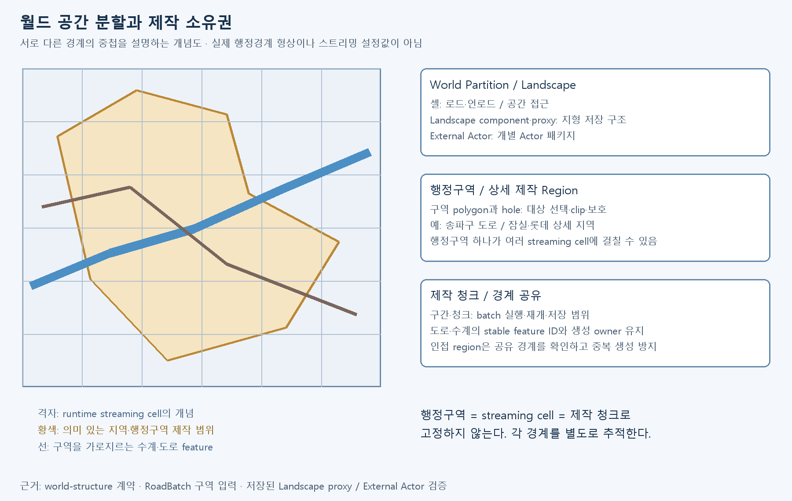
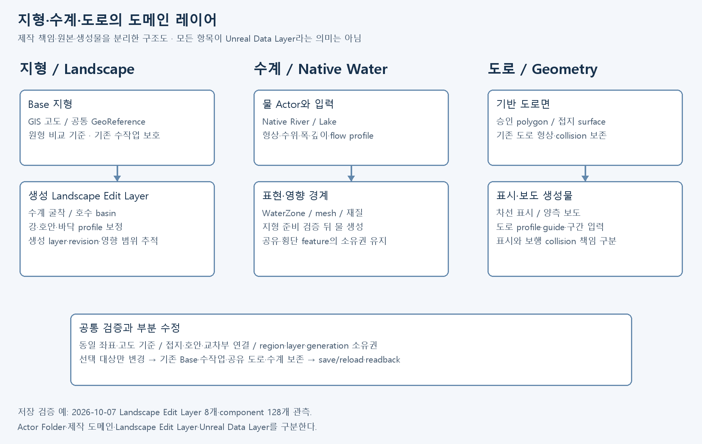

# World Production Case Study

> **Historical prototype case — NeoSeoul/GIS, 2026-10 checkpoints.** The large geographic-world pipeline and measurements below document work performed **before** the 2026-10-14 shift to a smaller, intentionally compressed linear exploration action-adventure. They are **not** proof that the new world, Houdini/procedural authoring strategy, content pipeline or target-platform performance has been implemented or validated. Current gameplay/world design is owned by private ProjectSF; this page preserves the earlier engineering evidence.

## Goal

**당시 프로토타입 목표:** 서울 기반 대규모 World 제작을 한 번의 생성 작업이 아니라 **반복 가능한 Production system**으로 구축합니다.

## Applied pipeline

~~~text
Approved geographic / authored source (historical GIS prototype)
→ canonical production input
→ terrain-production
→ landscape-production
→ road-production
→ water-terrain-preparation
→ water-production
→ world-structure
→ world-validation
→ Production Evidence
~~~

필요한 Skill만 현재 Step에 조합하며 “World 전부를 처리하는 거대한 Skill” 하나를 두지 않습니다.

## Historical applied examples

### Road

도로 원천에서 editable / regenerable road result를 만들고 다음을 구분합니다.

- source identity
- road design input
- generated output
- runtime representation
- human-editable representation
- partial regeneration boundary

대표 구간에서 geometry / grounding / junction / persistence를 검증한 뒤 확장합니다.

### Water

Water production 전에 terrain preparation을 별도 책임으로 검증합니다.

~~~text
water terrain preparation
→ verified bed / bank / datum
→ native river / lake production
→ depth / bank / connectivity validation
~~~

Water actor 생성만으로 완료 처리하지 않고 실제 지형, 수심, 연결, persistence를 확인합니다.

### Validation

대표 검증 대상:

- geometry fidelity
- grounding
- connectivity
- streaming boundary
- save / reload
- regeneration safety
- runtime cost where measured
- visual readability
- Owner review when required

## 공간 분할과 레이어 구조

월드는 **로드 단위, 제작 지역, 도메인 레이어, 제작 청크**를 각각 관리한다. 같은 좌표 위에 여러 경계가 겹치지만, 행정구역 하나를 World Partition 셀 하나나 생성 청크 하나로 고정하지 않는다.

| 분할 기준 | 책임과 실제 사용 |
| --- | --- |
| World Partition | 공간에 따른 로드·언로드와 Actor 접근. Landscape component·StreamingProxy 및 External Actor 패키지 구조를 확인하고 필요한 로드 범위에서 검증 |
| 행정구역·제작 Region | GIS 행정경계 polygon과 hole, 송파구·잠실/롯데 등의 상세 제작 범위. 대상 선택·clip·보호와 region 소유권의 기준 |
| 지형·수계·도로 도메인 | 원본·입력·생성물과 수정 책임을 분리. 지형 보정, 물 Actor, 도로면·표시·보도를 각각 추적하고 접지·연결은 함께 검증 |
| 제작 청크·구간 | 배치 생성·checkpoint·저장·재개 단위. 안정 feature/segment ID와 생성 owner를 유지하고 인접 구간의 경계 조건을 공유 |

공간 분할 개념도. 격자와 행정구역 형상은 관계를 설명하는 예시이며 실제 지도·셀 크기·runtime 설정값을 재현한 그림이 아니다. 구역을 가로지르는 도로·수계를 구역마다 별도 원본으로 복제하지 않고 feature identity와 생성 소유권을 추적한다.

### 지형 레이어

GIS 고도로 만든 Base를 비교·보존 기준으로 두고, 수계 굴착·호수 basin·강바닥·호안 보정을 생성 Landscape Edit Layer로 분리한다. 수정 범위와 생성 revision을 연결해 필요한 부분만 재검증한다. 2026-10-07 저장 상태 검증에서는 **Landscape Edit Layer 8개와 component 128개**를 관측했고, 보호 레이어와 최종 지형의 표본을 이전 기준과 비교했다. 이 숫자는 해당 checkpoint의 관측값이다.

### 수계 레이어

바닥·호안 지형 준비와 Native River/Lake 생성은 별도 책임이다. 물 Actor의 형상·수위·폭·깊이·flow 입력, WaterZone·mesh·재질을 연결하되 지형 준비 검증을 물 생성의 선행 조건으로 둔다. 공유 하천이나 호수를 여러 행정구역의 제작 작업에서 중복 생성하지 않도록 입력·Actor·생성 소유권을 확인한다.

### 도로 레이어

승인된 polygon 기반 도로면과 그 위의 차선 표시·보도를 분리한다. 기존 도로면·접지·collision을 보존하면서 profile·guide·구간 입력으로 표시와 보도를 제작한다. 차선 표시의 시각 표현과 보도의 보행 collision도 구분해 검증한다. 도로를 모두 Landscape 높이 레이어에 합쳐 제작하는 구조로 설명하지 않는다.

도메인 레이어 구조도. 여기서 레이어는 제작 책임의 구분이며 **Actor Folder, Landscape Edit Layer, Unreal Data Layer는 서로 다른 개념**이다. 지형의 Edit Layer 분리는 직접 관측했지만, 행정구역·수계·도로 각각이 Unreal Data Layer에 일대일로 구현됐다고 주장하지 않는다.

### 부분 수정과 공통 검증

송파구 도로 제작에서는 실제 행정구역 범위 안의 명시 구간을 선택하고, 기존 지형·수계·도로면·수작업을 보존하며 표시·보도를 확장했다. 지형 보정은 필요한 생성 Edit Layer와 영역으로, 수계 변경은 해당 Native Actor와 입력으로 범위를 좁힌다. 변경 후에는 접지·호안·교차부·인접 구간 연결, 저장/reload, 비대상 보존을 확인한다.

World Partition 셀 경계, Landscape proxy 경계, 행정구역 경계와 제작 청크 경계는 각각 추적한다. 저장·로드 관측이 실제 전체 경로의 streaming 품질·메모리·패키지 성능을 인증하는 것은 아니며, 목표 환경에서의 검증은 별도로 남긴다.

## Why this matters

대규모 World 제작에서 AI의 가치가 커지려면 한 번의 생성 품질보다 **입력, 수정, 재생성, 검증, 사람이 이어서 편집하는 흐름**이 유지되어야 합니다.

이 Case Study는 이전 ProjectSF 월드 프로토타입의 제작·검증 계약과 한계를 기록합니다. 신규 월드 구현 상태는 이 페이지에서 추정하지 않습니다.

## Screenshots and workflow example

[Agent-Driven Game Production 사례](AgentDrivenGameProduction.md#월드-제작-파이프라인을-만들고-실제-지역에-적용)에서 월드 제작 공정, 도로 전후 화면, 지역 rough와 검증 경계를 함께 확인할 수 있습니다.
