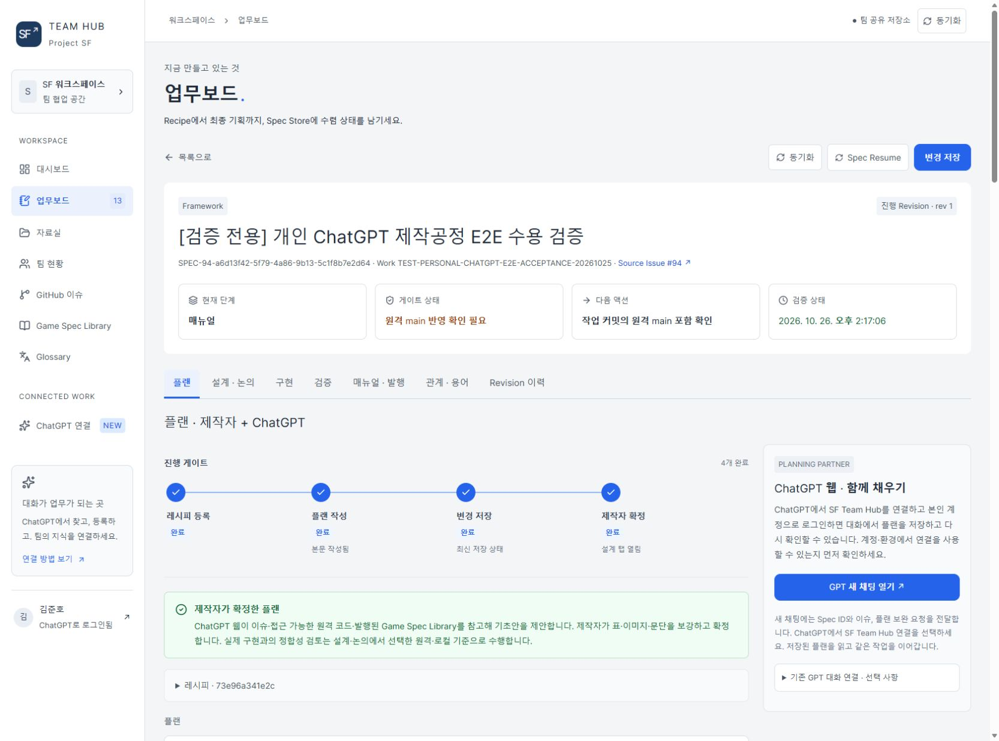
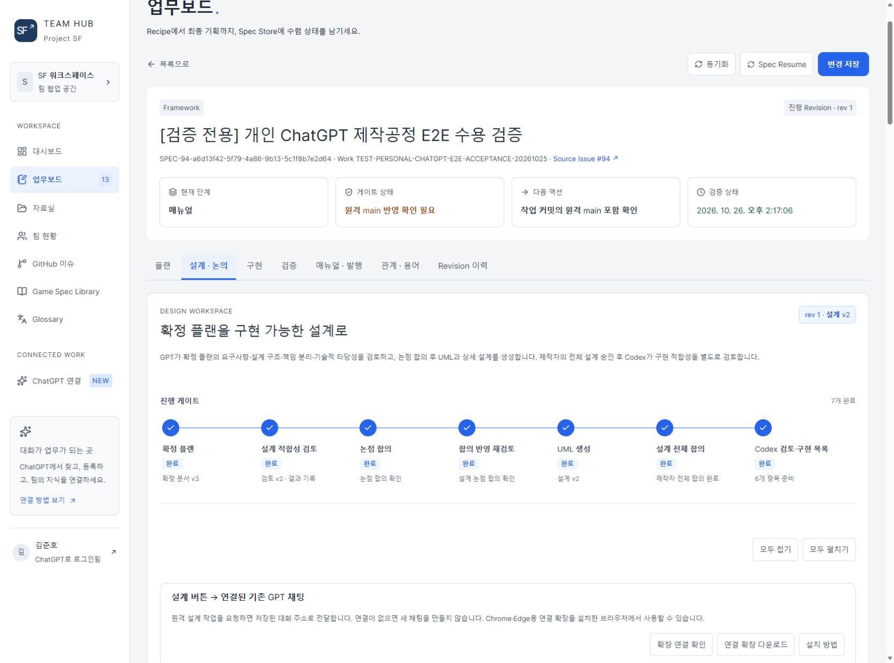
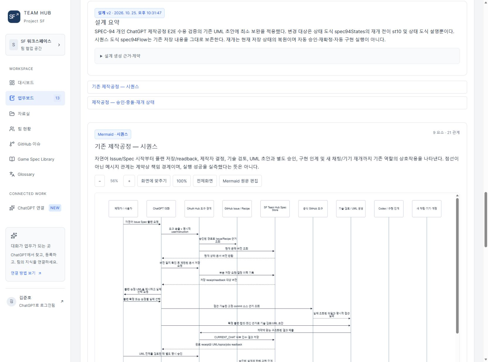
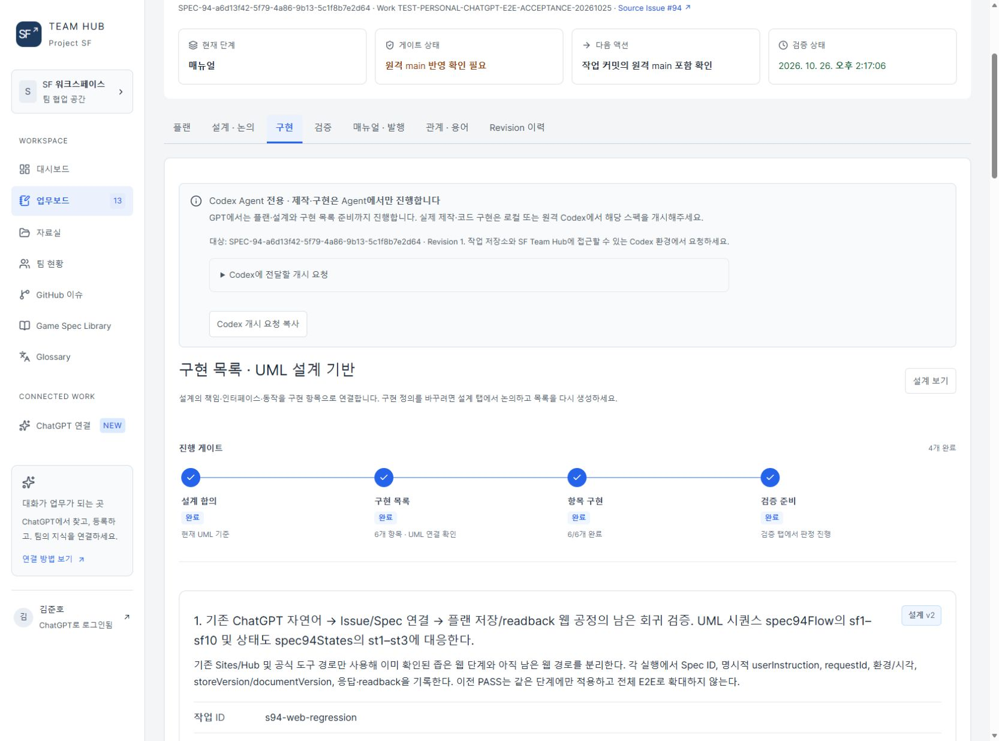
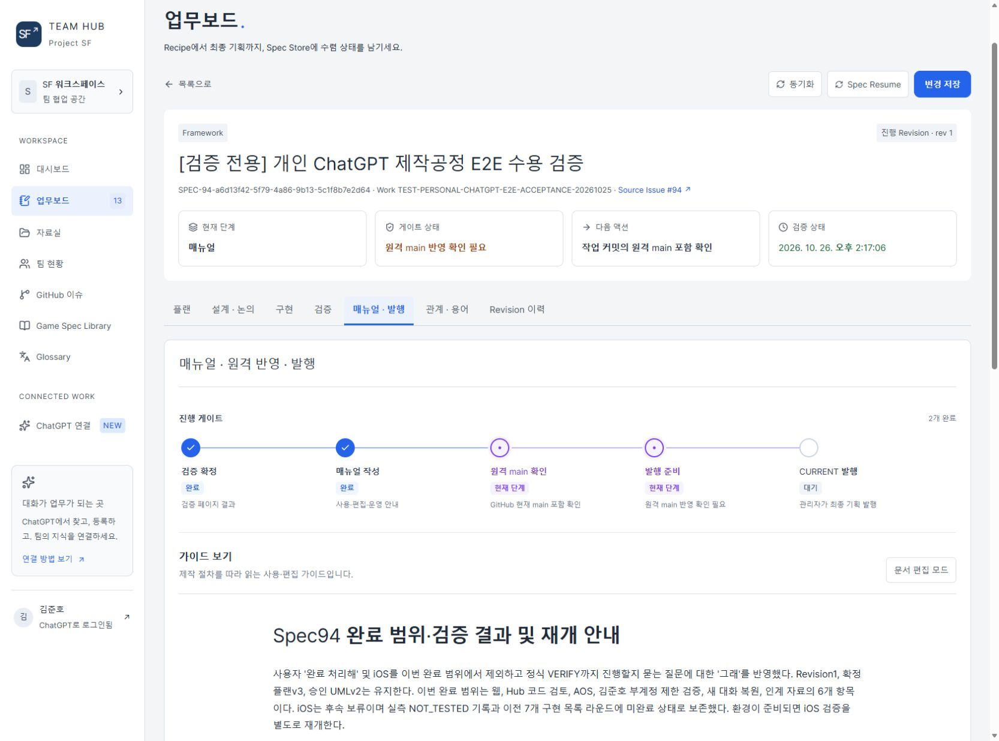
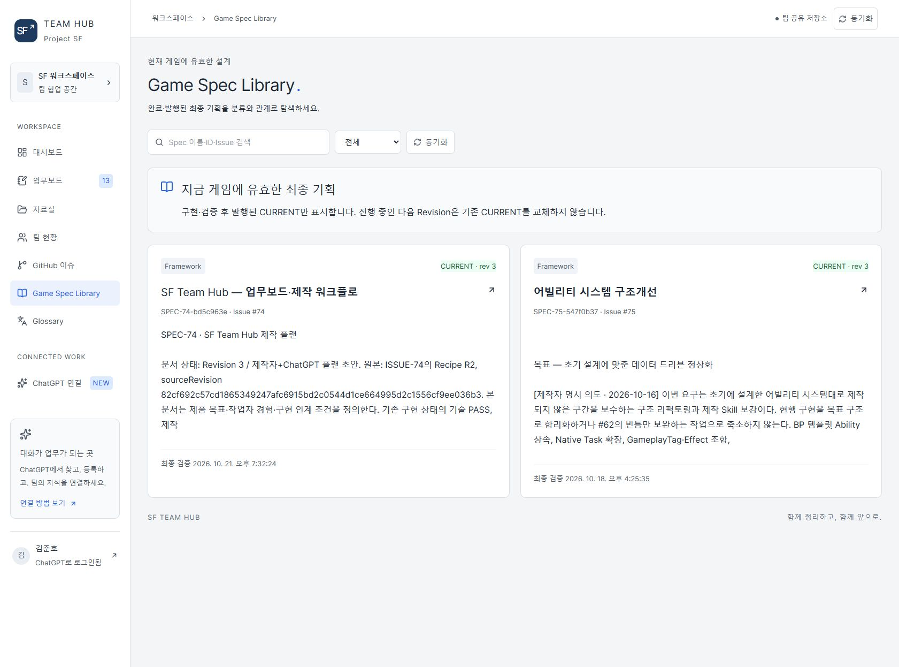

# SF Team Hub 사이트에서 진행하는 제작 공정

**2026-10-26 실제 운영 화면.** 팀원 계정별 플러그인 배포 대신 **공통 서버 MCP**를 사용해 GPT·Codex가 같은 Spec을 조회·저장·재조회합니다. 아래는 승인된 기존 계정으로 탐색한 실제 사이트입니다. 저장·합의·구현·발행을 캡처를 위해 재실행하지 않았습니다.

[21페이지 포트폴리오 PDF](Guides/AgentWorkflowPortfolio-20261026.pdf) · [현재 검증 결과와 한계](../CaseStudies/TeamHubProduction.md) · [실사 범위](SourceAudit-2026-10-26.md)

## 1. 플랜 작성과 제작자 확정

Creator와 GPT가 Recipe·기존 Issue를 읽고 목표·범위·보존·완료 조건을 구체화합니다. 문단·표·이미지 보완을 같은 Spec에 저장하고 receipt와 readback을 확인합니다. 제작자의 실제 확정으로 설계 기준 문서가 정해집니다. 저장과 확정은 별도입니다.

화면은 Spec94 플랜의 네 단계 완료를 보여줍니다. 상단의 현재 단계·차단 조건은 Spec 전체 상태이므로 플랜 탭 완료와 최종 발행을 구분합니다.

## 2. 설계 검토와 논점 합의

확정 플랜 → 설계 적합성 검토 → 논점 합의 → 합의 반영 재검토 → UML 생성 → 전체 설계 합의 → Codex 검토·구현 목록 순서입니다. GPT는 요구사항·설계 구조·책임·기술적 타당성을 검토하고 Creator가 실제 방안을 선택합니다. 논점 합의가 전체 설계 승인을 대신하지 않습니다.

설계 검토와 실제 구현 적합성 검토를 구분합니다. 코드·에셋·Unreal 실환경의 미검증을 설계 생성으로 해소했다고 처리하지 않고 Codex 후속 검토로 전달합니다.

## 3. UML과 설계 버전

설계 요약·도식·요소·관계를 저장하고, 구현 항목을 해당 설계 버전의 근거에 연결합니다. 설계가 바뀌면 영향을 받는 항목을 재검토합니다. 아래 시퀀스 도식은 제작자·GPT·서버 MCP·Spec Store·기술 검토·Codex·새 기기 간 책임을 설명합니다.

도식은 화면에 맞추기 56%로 표시된 일부이며 전체 화살표의 실행 성공을 증명하지 않습니다. 새 대화의 복원은 재승인이나 자동 구현 실행이 아닙니다.

## 4. Codex 구현과 항목별 완료

제작자는 Spec ID로 로컬·원격 Codex에 구현을 요청합니다. Codex는 현재 Revision·확정 플랜·승인 UML·구현 목록·실제 저장소·허용 효과를 읽고 진행합니다. 각 항목은 변경 내용, 선행 작업, 완료 조건, 검증 방법, UML 근거, 실제 결과와 다음 행동을 연결합니다.

화면의 6/6은 Spec94에서 승인된 여섯 검증·검토 항목의 완료입니다. 실제 결과 기록과 완료 상태 동기화를 확인하며 구현 완료와 검증 판정은 별도입니다.

## 5. AI 판정과 사람 판정

구현에 연결된 검증 항목의 기대 결과·필요한 증거·판정 주체를 정의합니다. 실제 관찰과 증거를 저장하고 AI 판정, 필요한 사람 수락과 근거를 따로 확인합니다. 정식 VERIFY는 필수 조건을 서버에서 검사한 뒤 확정합니다.

Spec94는 2026-10-26 14:17 KST 정식 VERIFY를 확인했습니다. 여섯 완료 항목의 근거 정합성에 대한 검증이며, iOS는 후속 보류입니다. 전체 플랫폼 E2E·전체 타입검사 성공을 주장하지 않습니다.

## 6. 매뉴얼과 원격 main 확인 및 발행

사용·편집·운영 가이드에 완료 범위와 재개 조건을 정리합니다. Agent는 변경 목록·커밋·원격 main 포함 여부를 확인해 근거를 기록하고, 필수 조건을 갖춘 후 관리자가 CURRENT를 발행합니다.

현재 Spec94는 검증과 매뉴얼이 완료됐지만 원격 main 확인이 남아 있습니다. 이 포트폴리오 저장소의 갱신을 Spec94의 원격 반영 판정·CURRENT 발행으로 자동 처리하지 않습니다.

## 7. CURRENT Library에서 발행본 재사용

업무보드는 작업 중인 상태를, Game Spec Library는 게임에 유효한 CURRENT를 보여줍니다. 다음 Revision이 진행 중이어도 이전 CURRENT를 유지합니다. 새 제작에서 발행 기획·관계·용어를 조회해 기존 시스템과 연결합니다.

화면은 SPEC-74 R3·SPEC-75 R3 발행 카드입니다. 진행 중인 Spec94를 발행된 정본으로 혼동하지 않습니다. 이후 Creator의 다음 목표와 Programmer의 종합 검토를 통해 제작과 공정을 개선합니다.
