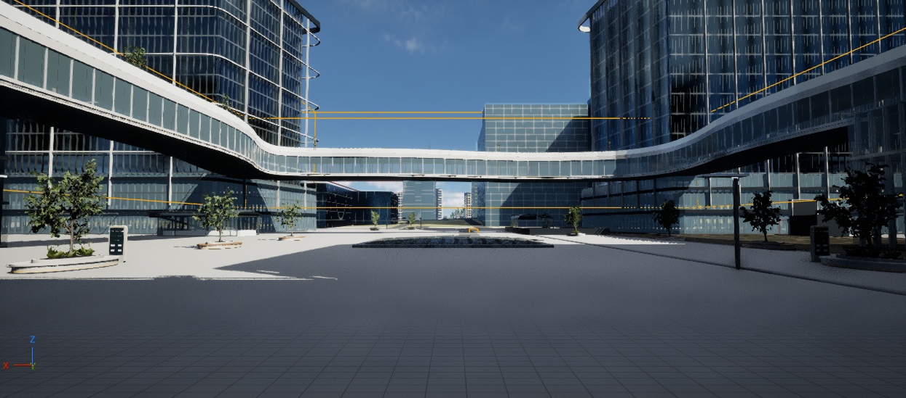

# Unreal Agent Workflow

**Creator가 확정한 Spec을 Agent가 구현하고, 실제 검증을 거쳐 다음 제작에 재사용하는 공정.** Unreal Engine 기반 게임 **Trace**에 적용한 ProjectSF의 공개 포트폴리오입니다.

[**워크플로 화면 보기**](Docs/SFTeamHubWorkflow.md) · [**발행까지 따라가기**](Docs/SFTeamHubWorkflow.md#기본-그래플링에서-확인한-스펙-실행과-발행) · [**제작 사례 둘러보기**](#제작-사례)

## Spec 기반 제작 워크플로

**플랜 확정 → 설계 합의 → Agent 구현 → 검증·Creator 수용 → CURRENT 발행**

SF Team Hub의 **Spec ID와 Revision**이 플랜, 설계, 구현 항목, 검증 기록을 연결합니다. 대화나 작업 환경이 바뀌어도 Agent는 같은 Spec의 현재 상태에서 이어갑니다.

- **Creator**는 만들 범위와 완료 조건을 정하고 실제 결과를 수용합니다.
- **Agent**는 승인된 설계를 구현하고, 항목별로 결과와 검증 근거를 남깁니다.
- **Programmer**는 완료된 작업을 종합 검토해 구조와 제작 공정을 개선합니다.

기술 검증, Creator 수용, 제품 main 반영은 각각 확인합니다. 발행된 Revision은 `CURRENT` Library에서 다음 제작의 기준으로 사용합니다.

## 제작 사례

| 사례 | 볼 수 있는 것 |
| --- | --- |
| [그래플링 이동 · SPEC-105](Docs/SFTeamHubWorkflow.md#기본-그래플링에서-확인한-스펙-실행과-발행) | 하나의 게임 기능이 승인 설계에서 자동화 78/78과 `CURRENT` 발행까지 이어진 과정 |
| [판교 시작 지역](CaseStudies/PangyoWorldProduction.md) | 지상 광장·도로, 지하 통로·환승부의 제작 화면과 전후 비교. 전체 지역은 제작 중 |
| [인벤토리와 락온](CaseStudies/GameplayWorkflow-20261113.md) | 실제 게임 화면과 발행 확인 범위. 그래플 자원·HUD 후속 작업은 별도 진행 중 |

*판교 광장 제작 화면. 이미지를 누르면 지상·지하 사례를 볼 수 있습니다.*

## 더 보기

[실제 Hub 화면 7장](Docs/SFTeamHubWorkflow.md) · [구현·검증 현황](Docs/ImplementationStatus.md) · [10월 26일 포트폴리오 PDF](Docs/Guides/AgentWorkflowPortfolio-20261026.pdf)

제작 공정·기술 사례·과거 기록 전체 보기

### 핵심 자료

| 주제 | 문서 | 내용 |
| --- | --- | --- |
| Agent Workflow | [제작 모델과 역할](Docs/CreatorCentricProduction.md) | Creator / AI Agent / Programmer의 책임과 품질 관리 |
| Agent Workflow | [구조 및 책임 경계](Docs/Architecture.md) | Workflow·Rule·Skill·Recipe·Runtime·Evidence |
| Agent Workflow | [실행·재개·검증](Docs/ExecutionModel.md) | Issue / Spec / 직접 요청, 최신 원본, 완료 판정 |
| 제작 사례 | [SF Team Hub 운영 사례](CaseStudies/TeamHubProduction.md) | 공통 서버 MCP, SPEC-74 발행과 SPEC-94 승인 범위 검증 |
| 제작 사례 | [SPEC-75의 Spec 워크플로우 진행](CaseStudies/AbilityWorkflow.md) | 제작자·Agent의 단계별 판단, 논점 합의와 재검토, 구현 인계·검증·발행 |
| Spec 공정 | [SF Team Hub 단계별 화면](Docs/SFTeamHubWorkflow.md) | 플랜·UML·구현·검증·발행 화면 7개와 그래플링의 실제 발행 사례 |
| 포트폴리오 | [10월 26일 Agent Workflow PDF · 9페이지](Docs/Guides/AgentWorkflowPortfolio-20261026.pdf) | 원격 개발 실험 → 이슈 기반 레시피 → 플랜·설계·구현 파이프라인의 발전 과정과 적용 사례 |
| 현재 월드 | [판교 시작 지역](CaseStudies/PangyoWorldProduction.md) | 광장·도로·지하 동선, 실제 Data Layer 관측과 HLOD 검증 범위 |
| 게임플레이 | [그래플링과 인벤토리](CaseStudies/GameplayWorkflow-20261113.md) | 그래플 이동·무기 착용·락온 리팩터링 및 후속 자원·HUD 상태 |
| 초기 제작 이력 | [월드·전투·기본 몬스터](CaseStudies/AgentDrivenGameProduction.md) | 이전 NeoSeoul GIS와 영역별 제작·검증 기록 |
| RPCNet | [네트워크 설계 및 검증](CaseStudies/RPCNet.md) | 상용 클라이언트 네트워크 설계 경험을 바탕으로 별도 개발한 통신 프레임워크 |
| RPCNet 검증 | [실제 서버·클라이언트 통신 검증](CaseStudies/ServerProduction.md) | RPCNet 테스트 목적으로 구성한 Gateway/AS/GS, 로그인·영속 상태·로컬 통신 검증 |

RPCNet은 실제 통신을 시험하기 위해 서버 기반을 직접 구성한 사례입니다. 이 서버는 별도 상용 온라인 서비스 출시 성과가 아니라 **RPCNet 통신 계약과 Unreal 연동의 실제 검증 환경**으로 소개합니다. 상용 프로젝트의 비공개 코드는 공개하지 않습니다.

### 추가 자료

- 제작 기준: [Creator의 작업 흐름](Docs/CreatorWorkflow.md) · [제작 입력과 Evidence](Docs/ProductionModel.md) · [Unreal MCP 실행 경계](Docs/MCPExecution.md)
- 제작 지침: [UI 제작](Docs/UIProduction.md) · [Recipe 작성](Docs/RecipeProduction.md) · [원본 지침 Snapshot](Reference/ProjectSF/README.md)
- 추가 사례: [월드 제작(이전 GIS 프로토타입)](CaseStudies/WorldProduction.md) · [DataForge](CaseStudies/DataForge.md)
- 상세 참고: [서버 아키텍처](Docs/Server/ServerArchitecture.md) · [Gateway 배포 설계](Docs/Server/GatewayDeploymentDesign.md) · [RPCNet 가이드 PDF](Docs/Guides/RPCNet_Protocol_to_Unreal_Client_Guide.pdf)
- 기록: [구현·검증 현황](Docs/ImplementationStatus.md) · [11월 13일 갱신 기준](Docs/SourceAudit-2026-11-13.md) · [10월 26일 공정 실사](Docs/SourceAudit-2026-10-26.md) · [2026-10-22 원본 실사 범위](Docs/SourceAudit-2026-10-22.md)

검증 기준과 공개 범위

비공개 ProjectSF가 원본이며, 이 저장소는 선별한 공개 Snapshot입니다. 제작 사례의 확인 기준은 [2026-11-13 기록](Docs/SourceAudit-2026-11-13.md)입니다. 10월 Hub 화면·PDF와 초기 NeoSeoul 사례는 각 시점의 기록으로 유지합니다.

작은 변경은 Issue 또는 직접 요청으로도 진행합니다. **Standard First, Simple is Best**를 공통 원칙으로 삼아 공식 Unreal 기능과 기존 도구를 먼저 사용합니다.

### 검증과 공개 범위

SF Team Hub는 **팀원별 플러그인 배포를 채택하지 않고 공통 서버 MCP로 검증**했습니다. 실제 조회·저장·readback, 새 대화의 Spec 상태 복원과 두 승인 계정의 Android 확인을 기록했습니다. SPEC-74 R3는 CURRENT 발행 이력이고, SPEC-94는 승인된 6개 항목의 정식 VERIFY 완료 상태입니다. iOS는 후속 보류이며 SPEC-94의 원격 main 확인·CURRENT 발행은 별도로 남아 있습니다.

기본 그래플링·인벤토리·락온 리팩터링은 제품 main과 Hub `CURRENT` 발행을 확인했습니다. 판교와 그래플 자원·HUD 후속 Spec은 구현 중입니다.

각 문서의 **PASS는 당시 명시된 검사 범위**에 한정합니다. 코드·Unreal Editor·서버를 이번 저장소 정리에서 재실행하지 않았습니다. 판교의 정적 제작·저장과 전체 플레이·패키지·성능 검증은 별도로 다룹니다. 운영 수준 HA·WAN 배포와 Unreal Dedicated Server 연동은 미완료입니다.

상용 코드·원본 게임 리소스·인증정보는 공개하지 않습니다. SF Team Hub 공정 화면과 해당 Spec 일부는 사용자의 포함 승인에 따라 선별했습니다. 비공개 작업 기록 전체를 복제하지 않습니다.

